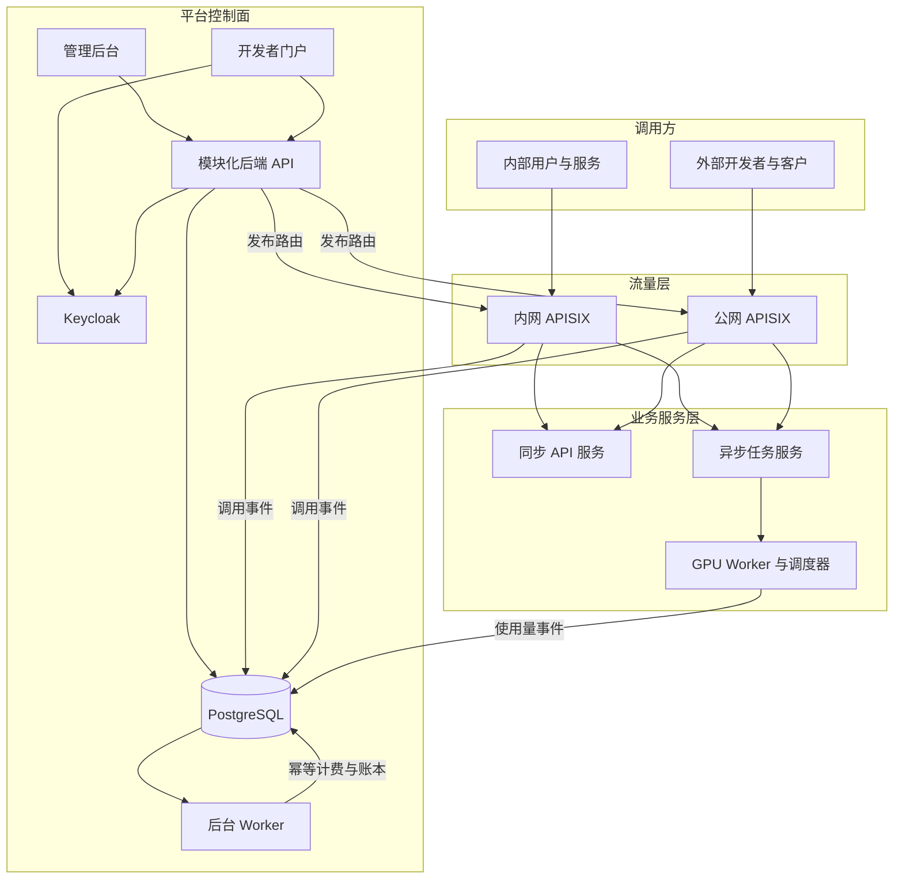
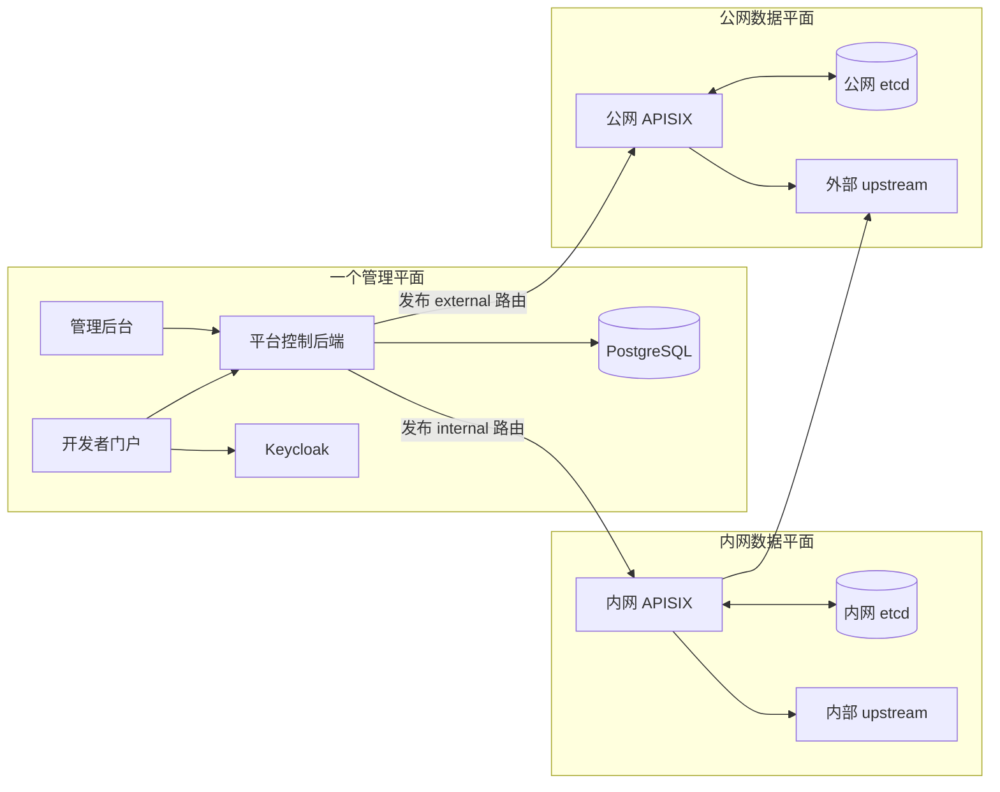
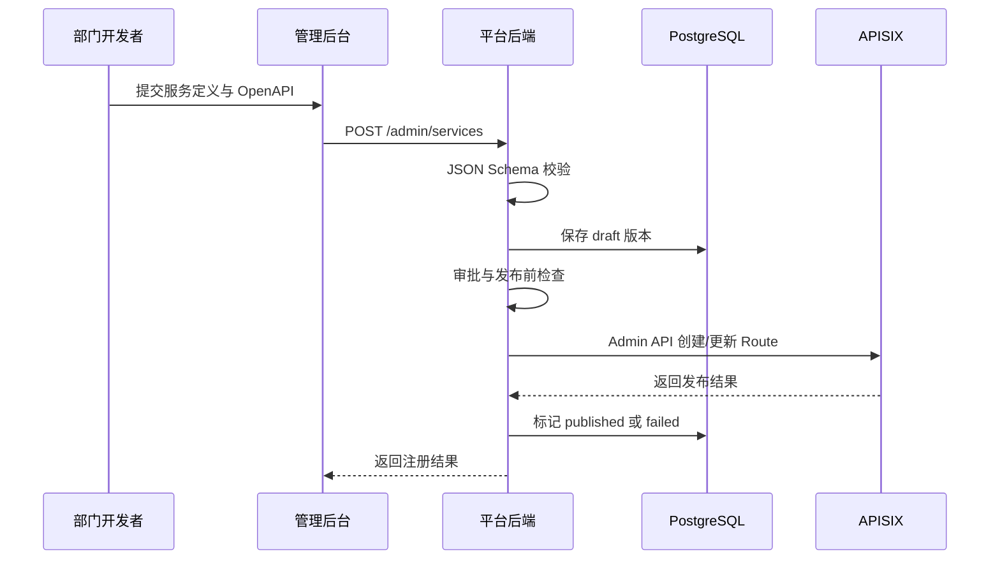
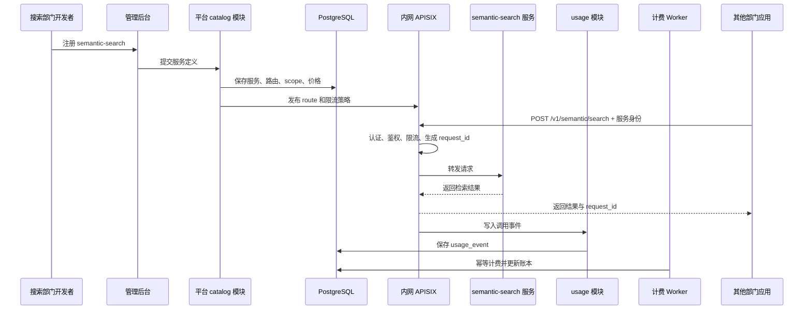
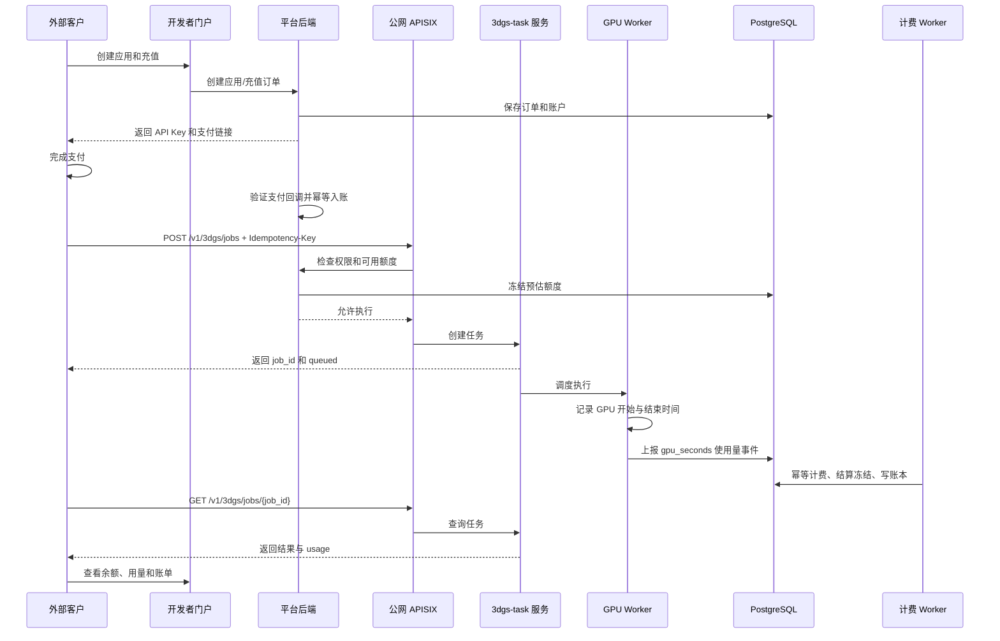

# 统一 API 接入与商业化平台技术方案

**报告版本：** v1.0  
**报告日期：** 2026-11-27  
**适用对象：** 架构评审人员、后端工程师、平台工程师、业务部门开发者  
**决策范围：** 起步阶段的技术选型、系统边界、核心数据流与实施顺序

---

## 摘要

公司当前同时面临两类问题：内部服务分散，缺少统一的调用入口和治理能力；业务能力具备对外收费潜力，但缺少账号、授权、计量、扣费和开发者自助使用能力。

本报告建议建设一个统一 API 平台，而不是仅部署一个 API 网关。平台采用 **Apache APISIX + Keycloak + PostgreSQL + 自研模块化单后端** 作为起步技术栈。APISIX 承担流量治理，Keycloak 承担身份认证，PostgreSQL 保存业务和财务数据，自研后端承担服务注册、业务权限、API Key、定价、使用量、账本和账单。

起步阶段不引入微服务、Kafka、ClickHouse 或 Kubernetes。后端保持一个代码库，Web API 与异步 Worker 可以作为同一代码库的两个进程运行。服务注册规范、统一计量事件和可审计账本是平台长期扩展的核心。

**结论：该方案可以满足内部统一调用和外部付费使用的硬性需求。进入开发前，必须补齐用量采集、并发预占、幂等扣费、路由发布补偿和内外网隔离的详细设计。**

---

## 1. 背景与公司当前困境

### 1.1 内部服务分散

随着业务服务增多，如果每个调用方都直接保存上游地址、认证方式和调用协议，会产生以下问题：

| 问题 | 具体表现 | 后果 |
|---|---|---|
| 地址耦合 | 调用方硬编码上游 IP、域名或端口 | 服务迁移时修改大量调用方 |
| 协议不一致 | 鉴权 Header、错误码、超时和重试规则各不相同 | 接入成本高，行为难以预测 |
| 权限不统一 | 密钥散落在代码、配置文件或不同平台 | 难以审计，撤销困难 |
| 流量不可控 | 缺少统一限流、并发限制、熔断和灰度能力 | 单个服务异常可能影响整条调用链 |
| 观测困难 | 日志格式不同，缺少统一请求 ID | 故障定位依赖人工拼接信息 |
| 能力难复用 | 每个团队重复实现认证、限流、日志和文档 | 基础设施重复建设 |

### 1.2 对外商业化缺少基础

内部服务能够提供技术能力，不代表已经形成可销售产品。外部客户使用前至少需要：

- 注册账号并加入组织。
- 获得访问凭证。
- 知道可以调用哪些接口、如何调用。
- 知道价格、余额和消费规则。
- 在调用后查看用量和账单。
- 在余额不足时充值或被限制调用。

如果这些能力分散在人工流程和不同系统中，会导致开户慢、计费不透明、客服成本高和财务风险。

### 1.3 服务类型持续扩展

当前既有按请求次数计费的 API，也有类似 3DGS 的 GPU 异步任务，未来还可能有语义识别、语音、图像、向量检索等能力。不同接口的请求形式、执行时间和资源消耗不同。

因此平台不能只围绕某一种接口设计，而应提供稳定的接入协议，将业务实现和计费指标抽象出来。

---

## 2. 业务需求与边界

### 2.1 硬性需求

1. 内部服务统一注册、发布和调用。
2. 内部 Server 之间通过统一平台中转。
3. 提供账号系统，并支持用户、组织和 API 权限管理。
4. 提供外部客户注册和自助使用入口。
5. 支持按量扣费、余额、账本和账单。
6. 支持调用统计和消费统计。
7. 支持按成功请求次数和 GPU 实际运行时间计费。
8. 后续服务类型可以扩展。

### 2.2 非目标

起步阶段不把以下能力纳入平台核心：

- GPU 资源采购、集群调度和任务执行。
- 自动监控物理 GPU 利用率。
- 从 HTTP 请求耗时推断 GPU 时长。
- 套餐、优惠券、阶梯折扣和复杂营销规则。
- 自动发票和复杂合同管理。
- 用平台替代业务服务自身的领域逻辑。
- 一开始拆成大量微服务。

### 2.3 核心边界

| 系统 | 负责 | 不负责 |
|---|---|---|
| APISIX | 流量入口、认证校验、路由、限流、超时、日志、追踪 | 余额、定价、充值、账单 |
| Keycloak | 用户注册登录、OIDC、用户组 | 具体 API 权限和计费规则 |
| 自研后端 | 服务注册、业务权限、API Key、定价、计量、账本 | 替代业务 API 执行业务任务 |
| GPU 业务服务 | 任务执行、排队、GPU 开始和结束计量 | 决定平台价格和用户账本 |
| 开发者门户 | 应用、Key、文档、用量、余额和账单展示 | 直接修改账目或价格 |

---

## 3. 总体技术方案

### 3.1 逻辑架构



### 3.2 部署形态

本方案明确采用 **两个 APISIX 实例、一个管理平面**。内网和公网网关分别部署，但共用管理后台、开发者门户、平台后端、Keycloak 和 PostgreSQL。

```text
管理平面（1 套）
  管理后台 + 开发者门户 + 平台后端
                    │
          ┌─────────┴─────────┐
          ▼                   ▼
数据平面（2 套）
  内网 APISIX             公网 APISIX
  内网 etcd               公网 etcd
```

两个实例不是两套平台，而是两个独立流量入口：

- 内网 APISIX 只允许公司网络访问，只能访问被授权的内部 upstream 和已公开 upstream。
- 公网 APISIX 允许互联网访问，只能访问明确发布的外部 upstream。
- 公网实例不能配置内部 upstream，不能暴露内部路由。
- 两个实例使用两套独立 etcd，避免路由误同步和故障互相影响。
- 控制后端持有两套发布配置，按目标网关分别调用 Admin API。
- 第一期每个网关可以先部署一个实例；生产环境再按可用性要求增加到 2～3 个节点。



### 3.2.1 一个管理平面如何管理两个实例

管理员只使用一个后台。服务定义中的 `visibility` 决定发布目标：

| `visibility` | 发布目标 | 调用方 |
|---|---|---|
| `internal` | 内网 APISIX | 内部用户、内部服务 |
| `external` | 公网 APISIX | 外部客户，也允许内部调用 |
| 同一服务同时允许内外网访问 | 两个 APISIX 实例 | 内外部调用方 |

后端保存一份服务定义，并为每个目标网关保存独立的发布记录：

```text
service
route
route_publication
  route_id
  gateway_instance
  publication_status
  external_route_id
  published_at
```

管理页面展示两个发布状态，但不需要管理员切换两个后台。开发者门户也只有一个，内外部用户共用账号、组织、API Key、价格和账本。

### 3.2.2 为什么采用两个实例

1. **安全边界清晰**：公网流量不能直接访问内部 upstream，错误发布路由仍受到网络策略约束。
2. **故障域隔离**：公网攻击、流量突增或插件故障不直接影响内部调用。
3. **流量独立扩缩容**：内网和公网可以使用不同节点数、带宽和限流策略。
4. **配置独立升级**：证书、WAF、DDoS 防护和 APISIX 版本可以分别演进。
5. **防止配置互相污染**：两套 etcd 和两套消费者配置避免内网路由误同步到公网。

该设计增加的只是一套网关部署和发布配置，不增加账号系统、业务后端、数据库或开发者门户。

### 3.3 单后端模块划分

```text
backend/
├── auth/             身份与内部服务认证
├── tenancy/          组织、项目、成员、角色
├── catalog/          服务注册、路由、文档
├── credentials/      应用与 API Key
├── pricing/          计费指标、单价、价格版本
├── usage/            使用量事件、去重、重试
├── billing/          账户、冻结、扣费、账本、账单
├── payments/         充值订单、支付回调、退款
├── stats/            调用和消费统计
└── admin/            管理操作与审计
```

这些是代码模块，不要求分别部署。后台任务处理程序与 Web API 共用代码库和数据库，可以独立运行进程。

---

## 4. 技术选型及理由

### 4.1 选型结论

| 能力 | 起步选型 | 后期选型 | 选型理由 |
|---|---|---|---|
| API 网关 | Apache APISIX | 继续使用或多实例扩展 | 开源、动态路由、插件丰富、Admin API 可编程 |
| 网关存储 | etcd | 独立 etcd 集群 | APISIX 常见部署形态，保存动态配置 |
| 身份认证 | Keycloak | 继续使用 | OIDC 标准、用户组、第三方身份、减少账号系统开发 |
| 业务与账务数据库 | PostgreSQL | PostgreSQL + ClickHouse | 事务、约束、行锁适合资金数据，SQL 生态成熟 |
| 事件队列 | PostgreSQL 事件表 | Kafka | 初期减少组件，后期提升吞吐和解耦 |
| 调用分析 | PostgreSQL 聚合表 | ClickHouse | 初期数据量可控，后期分析独立 |
| 监控 | Prometheus + Grafana | 继续扩展 | 云原生监控事实方案之一 |
| 追踪 | OpenTelemetry | 继续扩展 | 标准化 trace 和上下文传播 |
| 文档 | OpenAPI | 继续扩展 | 机器可读，支持文档和 SDK 生成 |
| 部署 | Docker Compose | Kubernetes | 起步简单，后续平滑迁移 |

### 4.2 为什么选择 APISIX

APISIX 提供统一入口所需的动态路由、消费者、认证、限流、日志和可观测能力。平台后端可以通过 Admin API 创建和更新路由，而不是每个业务团队手工修改网关。[R2][R3]

采用 APISIX 后，业务团队复用统一的认证、限流、日志和追踪能力，避免各服务重复建设。Key Auth 插件可用于 API Key 校验，限流能力可配置在 API、消费者等粒度。[R4][R5]

需要强调：APISIX Dashboard 主要服务网关运维。它不是完整开发者中心，也不替代余额、账本和计费模块。

### 4.3 为什么选择 Keycloak

Keycloak 提供 OIDC、用户、用户组、角色和管理能力。使用它可以减少注册、登录、密码、第三方身份和账号安全的开发量。[R7]

但 Keycloak 的角色不等于业务授权。例如“用户属于研发组”不能自动说明“该用户可以调用 3DGS 写接口”。API 权限、组织配额和计费关系仍由自研后端保存。

建议采用：

- 管理端：Keycloak JWT。
- 外部机器调用：平台签发的 API Key。
- 内部服务调用：服务身份或内部 JWT。
- 最终业务权限：自研后端维护的授权关系。

### 4.4 为什么选择 PostgreSQL

平台的核心数据不是普通缓存，而是必须可审计、可重试和保持一致的业务与财务数据。PostgreSQL 提供事务、外键、唯一约束和行锁，适合实现余额、账本和幂等扣费。[R8][R9]

起步阶段将使用量事件和待处理任务放入 PostgreSQL，优点包括：

- 减少消息中间件数量。
- 与业务事务处于同一数据库。
- 支持唯一约束和幂等。
- 支持后台扫描未处理记录。
- 排错和恢复路径简单。

当事件量或消费吞吐超过单库承受能力时，再引入 Kafka；当明细分析影响交易库时，再引入 ClickHouse。

### 4.5 为什么选择模块化单后端

起步阶段的第一目标是降低接入和计费落地成本，而不是组织规模的“先进性”。单后端具有以下优势：

- 一个代码库、一套构建和发布流程。
- 跨模块事务简单。
- 本地调试和故障定位成本低。
- 不需要维护服务注册、服务发现和分布式事务。
- 可以通过模块边界保留未来拆分空间。

这里的“单后端”不意味着单进程。Web API 和 Worker 可以独立扩缩容，但仍共享同一领域代码和数据库。

---

## 5. 形式化系统定义

形式化的目的不是增加数学装饰，而是把权限、计费和一致性要求表达成可测试的约束。

### 5.1 服务定义

一个可注册服务定义为：

```text
Service = (service_id, owner, visibility, routes, auth, pricing)

Route = (route_id, method, path, upstream, timeout, scopes)

Pricing = (metric, currency, unit_price_minor, version, effective_from)
```

其中：

```text
visibility ∈ {internal, external}
metric ∈ {request, gpu_seconds, fixed}
unit_price_minor ∈ Z 且 unit_price_minor ≥ 0
```

注册必须满足：

```text
service_id 全局唯一
route_id 在服务内唯一
pricing.metric 已被平台支持
visibility = external 时，upstream 必须在允许发布的地址范围内
每个路由必须声明所需 scope
```

以后新增 `token`、`characters` 等 metric，只需扩展 metric 注册表和计价器，不需要改变网关调用协议。

### 5.2 权限判定

定义授权函数：

```text
Allow(principal, action, resource) -> Boolean
```

最小判定条件：

```text
Allow(p, call, r)
=
Enabled(p)
AND Member(p, organization(r))
AND HasScope(p, scope(r))
AND RouteVisible(r, p)
AND RateLimitPass(p, r)
```

账户余额检查是额外的财务约束：

```text
AllowCharge(p, r)
=
available_balance(account(p)) ≥ estimated_charge(p, r)
```

API Key 的权限不能超过所属组织和应用的权限。内部服务身份也只能访问明确授予的路由。

### 5.3 计费函数

使用量事件定义为：

```text
UsageEvent = (
    event_id,
    request_id,
    job_id,
    api_id,
    principal_id,
    organization_id,
    metric,
    quantity,
    result,
    occurred_at
)
```

费用函数：

```text
Charge(e) =
    quantity × unit_price_minor
    if result 属于收费结果
    and metric 属于 API 配置的收费 metric
    else 0
```

GPU 任务的计费为：

```text
gpu_seconds = Σ(gpu_finished_at - gpu_started_at)
charge_minor = ceil_to_billing_unit(gpu_seconds)
                × gpu_second_price_minor
```

HTTP 请求持续时间只进入性能统计，不进入 GPU 计费公式。

### 5.4 幂等约束

计费处理器必须满足：

```text
Process(e) 执行一次与执行多次，对账户和账本的影响相同
```

实现约束：

```text
UNIQUE(usage_events.event_id)
UNIQUE(ledger_entries.idempotency_key)
UNIQUE(payment_orders.provider, provider_order_id)
UNIQUE(refund_orders.provider, provider_refund_id)
```

### 5.5 账户不变量

账户始终满足：

```text
balance_minor ≥ 0
frozen_minor ≥ 0
balance_minor ≥ frozen_minor
available_minor = balance_minor - frozen_minor
```

如果业务允许欠费，必须显式增加 `credit_limit_minor`，并单独定义不变量；起步阶段建议不允许欠费。

### 5.6 并发正确性

对于账户 `a` 和金额 `m`：

```text
原子操作：
1. SELECT account FOR UPDATE
2. 检查可用额度
3. 修改 balance/frozen
4. 写 ledger
5. 提交事务
```

不能采用“先无锁读取，稍后无锁扣减”的方式，否则两个并发请求可能同时通过余额检查。

### 5.7 状态机约束

充值订单：

```text
CREATED -> PAYING -> PAID -> COMPLETED
                 \-> FAILED
                 \-> CLOSED
```

退款订单：

```text
CREATED -> PROCESSING -> SUCCEEDED
                      \-> FAILED
```

异步任务：

```text
QUEUED -> RUNNING -> SUCCEEDED
                  \-> FAILED
                  \-> CANCELLED
```

状态只能沿合法边迁移。重复回调、重复 Worker 消息和人工重试不能造成重复状态迁移或重复资金变化。

---

## 6. 统一服务注册规范

服务接入不应依赖口头约定。建议发布版本化的 YAML/JSON Schema，接入方提交结构化定义，平台校验后生成路由、权限和文档。

### 6.1 同步按次计费服务示例

```yaml
apiVersion: platform.example.com/v1
kind: RegisteredService

metadata:
  id: semantic-search
  name: 语义检索
  owner: search-team
  visibility: external

spec:
  upstream:
    url: http://semantic-search.internal:8080

  routes:
    - id: search
      method: POST
      path: /v1/semantic/search
      timeout: 30
      scopes: [semantic:write]
      openapiPath: /openapi.json

  auth:
    type: api_key

  pricing:
    metric: request
    unit: request
    unitPrice: "0.0300"
    currency: CNY
```

### 6.2 GPU 异步任务服务示例

```yaml
apiVersion: platform.example.com/v1
kind: RegisteredService

metadata:
  id: 3dgs
  name: 3DGS 生成
  owner: vision-team
  visibility: external

spec:
  routes:
    - id: create-job
      method: POST
      path: /v1/3dgs/jobs
      timeout: 10
      scopes: [3dgs:write]
      operationType: async_submit

    - id: get-job
      method: GET
      path: /v1/3dgs/jobs/{job_id}
      timeout: 10
      scopes: [3dgs:read]
      operationType: async_status

  pricing:
    metric: gpu_seconds
    unit: gpu_second
    unitPrice: "0.0200"
    currency: CNY
    billingUnit: 1
    rounding: ceil
```

### 6.3 注册与发布流程



必须保存 `draft -> validating -> publishing -> published/failed` 状态。如果 APISIX 发布失败，应允许重试，不能只在页面上显示“发布中”。

---

## 7. 场景一：其他部门开发者接入平台

### 场景说明

搜索部门已经有一个语义检索服务，希望其他部门调用，同时复用平台的身份认证、权限、限流、日志、统计和后续计费能力。

### 7.1 主脉络数据流



### 7.2 部门开发者需要做什么

1. 服务提供稳定的 HTTP 接口。
2. 提供 OpenAPI 文档。
3. 按注册规范声明路由、权限、超时和计费 metric。
4. 明确成功、失败、超时的业务语义。
5. 在响应和日志中保留平台传入的 `request_id`。
6. 为异步任务实现 `job_id` 和真实使用量上报。

部门开发者不需要：

- 开发用户注册和登录。
- 自行维护跨部门密钥。
- 为每个调用方重复实现限流。
- 自己实现扣费和账单。
- 直接修改 APISIX 配置。

### 7.3 平台复用的能力

| 能力 | 提供方 | 部门获得的价值 |
|---|---|---|
| 统一地址和路由 | APISIX + catalog | 不依赖上游物理地址 |
| 身份认证 | Keycloak + 服务身份 | 不重复建设账号系统 |
| API 权限 | tenancy + credentials | 按组织和 scope 授权 |
| 限流和并发控制 | APISIX | 防止突发流量打垮服务 |
| 日志和追踪 | APISIX + OpenTelemetry | 统一排查调用链 |
| 计量和计费 | usage + billing | 不自行开发账务 |
| 调用统计 | stats | 查看使用方和调用趋势 |

---

## 8. 场景二：外部客户使用内部能力

### 场景说明

外部客户希望调用公司的 3DGS 生成接口，按 GPU 实际运行秒数付费。

### 8.1 首次使用准备

```text
客户注册 Keycloak 账号
→ 创建组织
→ 创建应用
→ 获得 API Key
→ 充值
→ 选择已发布的 3DGS API
```

### 8.2 调用与计费主脉络



### 8.3 外部客户看到的产品能力

- 账号和组织管理。
- 应用与 API Key 管理。
- API 文档和调用示例。
- 余额和充值记录。
- 调用量、GPU 用量和费用明细。
- Key 撤销和权限范围设置。

### 8.4 平台内部必须保证的能力

- 公网入口无法访问内部 upstream。
- API Key 与组织、应用和 scope 绑定。
- 额度不足时拒绝创建新任务。
- 支付回调验签并幂等。
- GPU 使用量只接受内部服务上报。
- 重复任务提交、重复使用量事件和重复支付通知不重复扣费。

---

## 9. 账号、权限与 API Key

### 9.1 数据模型

```text
users
organizations
organization_members
roles
role_permissions
projects
applications
api_keys
api_key_scopes
service_scopes
```

### 9.2 三类凭证

| 凭证 | 使用者 | 用途 |
|---|---|---|
| Keycloak JWT | 管理后台和门户用户 | 用户身份认证 |
| API Key | 外部应用 | 调用公开 API |
| 内部服务身份 | 内部 Server 和 Worker | 调用内部 API、上报使用量 |

API Key 必须支持权限范围、过期、撤销、轮换、最后使用时间和脱敏展示。数据库中应保存 Key 的哈希或受保护形式，不明文展示完整密钥。

---

## 10. 计费、余额、充值与退款

### 10.1 账户模型

```text
available_minor = balance_minor - frozen_minor
```

起步阶段不允许欠费。所有资金变动通过账本记录：

```text
recharge / internal_grant / usage_charge / refund
freeze / unfreeze / manual_adjustment
```

### 10.2 同步按次计费

为了避免并发超支，建议按次 API 也采用轻量预占：

```text
调用前：冻结一个接口最大单价
调用后：成功则确认扣费，失败则释放
```

如果业务坚持调用后扣费，必须设置并发限制，并允许小额欠费或通过原子余额扣减保证一致性。

### 10.3 GPU 计费

GPU worker 上报：

```json
{
  "event_id": "evt_job_001",
  "job_id": "job_001",
  "api_id": "3dgs_generate",
  "organization_id": "org_001",
  "metric": "gpu_seconds",
  "quantity": 120,
  "gpu_type": "A10",
  "result": "succeeded",
  "occurred_at": "2026-11-27T10:02:00Z"
}
```

平台不验证物理 GPU 是否真实运行，但必须验证上报方是可信内部服务。`event_id` 和 `job_id` 用于去重。原始开始、结束时间和 worker 信息应保存，供审计和异常处理。

### 10.4 支付充值

起步阶段可以先支持：

- 内部组织管理员发放额度。
- 企业客户对公转账。
- 财务人工确认到账。

第二期接入一个在线渠道：

- 国内：微信支付或支付宝。
- 海外：Stripe。

在线充值流程：

```text
创建订单 -> 渠道支付 -> 服务端回调 -> 验签 -> 幂等入账 -> 写账本
```

不能根据浏览器跳转成功直接增加余额。渠道订单号必须唯一，同一通知只能入账一次。

### 10.5 退款

起步阶段可以只支持可用余额的原路或人工退款：

```text
申请退款 -> 冻结退款金额 -> 创建退款单 -> 渠道处理
-> 成功后解冻并扣减余额 -> 写退款账本
```

退款失败则解冻。部分退款、手续费和充值订单原路退款可以作为后续能力。

---

## 11. 可观测性与运行保障

### 11.1 日志字段

每次调用至少关联：

```text
timestamp
request_id
route_id
api_id
principal_id
organization_id
status
latency_ms
upstream
event_id
```

### 11.2 关键指标

- 请求量、成功率、P95/P99 延迟。
- 认证失败和限流次数。
- 上游超时和错误率。
- 使用量事件积压数量。
- 计费失败和重试次数。
- 重复事件拦截数量。
- 账户负余额异常。
- 支付回调失败和对账差异。

### 11.3 可用性与恢复

- APISIX、Keycloak、后端 API 和 Worker 至少双实例。
- PostgreSQL 使用主备或托管高可用方案，并验证恢复流程。
- Worker 应能扫描未处理事件重新执行。
- 支付回调保存原始载荷和处理状态。
- 路由发布失败可重试，页面展示真实状态。
- 每笔财务操作保留操作人、时间和原因。

---

## 12. 公司实践案例佐证

以下案例用于证明网关模式、动态治理和开发者门户分离具有工程实践基础。案例材料主要来自 Apache APISIX 官方用户案例，适合作为选型参考，但不能替代本公司的容量测试和安全评审。

### 12.1 腾讯：统一网关承载大规模内部流量

APISIX 官方案例介绍了腾讯内部 OTeam 使用 APISIX 的建设背景，包括内部系统演进、传统架构中通用能力的重复建设，以及网关在统一治理中的作用。[R10]

对本项目的启示：

- 统一认证、限流和日志可以成为跨团队复用的基础设施。
- 网关适合承载内部服务治理。
- 平台化可以减少各团队重复建设通用能力。

### 12.2 又拍云：公网网关与 Ingress 分离

又拍云案例说明其将 APISIX 用于公网网关和 Ingress 网关场景，并讨论稳定性、开源与扩展性等选型因素。[R11]

对本项目的启示：

- 公网与内部流量可以按场景划分。
- 网关是流量层，不应承担所有业务运营功能。
- 稳定性和扩展性需要在部署、插件和运维层共同保证。

### 12.3 联想：去中心化网关与集中式开发门户

联想案例介绍了基于 APISIX 建立轻量、去中心化网关和集中式开发门户的实践。[R12]

对本项目的启示：

- 流量接入网关和开发者入口可以分离。
- 集中式开发者体验不意味着所有业务流量必须集中到一个管理界面。
- APISIX Dashboard 不是完整开发者门户。

### 12.4 AWS：Usage Plan 与 API Key

Amazon API Gateway 将 API 作为产品提供时，可使用 usage plan 和 API key 控制可访问的 API、限流和配额。[R13]

对本项目的启示：

- API Key 是客户访问凭证，不等于完整身份和计费系统。
- 密钥、配额、套餐和计费应建模为不同概念。
- 外部商业化需要产品化能力，而不仅是路由代理。

### 12.5 Stripe：幂等请求

Stripe 官方文档说明，通过 idempotency key 可以安全重试请求，而不重复执行同一操作。[R14]

对本项目的启示：

- 充值、退款、任务创建和扣费都需要幂等。
- 网络超时后的重试是正常情况，不是异常边缘情况。
- 幂等键应进入数据库唯一约束，而不仅是应用内存缓存。

---

## 13. 可复用性与软件工程分析

### 13.1 能力复用

| 复用层次 | 复用什么 | 谁受益 |
|---|---|---|
| 协议复用 | OpenAPI、服务注册 Schema、计量事件 | 所有接入部门 |
| 基础设施复用 | 网关、Keycloak、数据库、监控 | 所有服务 |
| 平台能力复用 | 权限、Key、限流、统计、计费 | 内外部用户 |
| 代码复用 | 单后端模块和 Worker | 平台团队 |
| 部署复用 | Compose 模板、配置模板 | 开发、测试、生产 |

### 13.2 变更影响

新增一个按次计费接口时，主要变更是：

```text
服务配置 + OpenAPI + 计价器注册 + 测试
```

不需要修改：

- 网关核心代码。
- 登录系统。
- 账本表结构。
- 外部开发者门户整体架构。

新增 GPU 任务接口时，增加：

```text
异步任务协议 + worker 使用量上报 + 额度预占规则
```

### 13.3 演进策略

采用“模块化单体优先，按瓶颈拆分”的策略：

```text
一个后端
→ Web API 与 Worker 分进程
→ 独立使用量消费服务
→ 独立计费服务
→ 大数据分析链路
```

每一步都由实际容量、团队边界或合规需求驱动，不提前进行大规模分布式改造。

---

## 14. 风险与应对

| 风险 | 影响 | 应对 |
|---|---|---|
| 用量事件丢失 | 漏计费 | 持久化事件表、失败重试、定期对账 |
| 重复事件 | 重复扣费 | 全局幂等键和唯一约束 |
| 并发超支 | 余额为负 | 调用前预占、行锁、原子操作 |
| 路由发布失败 | 页面与实际不一致 | 发布状态机、失败补偿 |
| 公网访问内网 | 数据泄露 | 独立公网实例或严格网络策略 |
| GPU 数据不真实 | 少计费 | 内部身份、审计记录、异常检测 |
| 单库成为瓶颈 | 性能下降 | 索引、分区、归档，后期 ClickHouse/Kafka |
| 支付重复通知 | 重复充值 | 渠道订单唯一约束和事务入账 |
| 业务团队不愿改造 | 接入缓慢 | 提供模板、适配层和试点服务 |

---

## 15. 实施计划

### 阶段一：内部统一入口

- 部署 APISIX。
- 接入 2～3 个试点内部服务。
- 统一路由、服务身份、超时、限流和日志。
- 保存调用事件和基础统计。

验收标准：内部试点服务通过统一网关调用，能够按 `request_id` 排查问题。

### 阶段二：账号、权限和按次计费

- 接入 Keycloak。
- 实现组织、成员、角色、应用和 API Key。
- 实现服务注册、价格版本、余额和账本。
- 实现使用量幂等处理和按次扣费。
- 提供管理员充值。

验收标准：内部用户和测试外部用户可以按权限调用，成功请求准确扣费，重复事件不重复扣费。

### 阶段三：GPU 异步任务

- 统一任务提交与查询协议。
- 实现额度预占和结算。
- GPU worker 上报真实 GPU 秒数。
- 处理任务失败、取消、重试和重复上报。

验收标准：同一任务可重复查询和重试，不重复计费；实际费用正确结算。

### 阶段四：外部商业化

- 完善开发者门户。
- 接入一个支付渠道。
- 支持在线充值和原路退款。
- 提供客户账单和对账工具。

### 阶段五：规模化

- 根据数据量引入 ClickHouse。
- 根据吞吐引入 Kafka。
- Web API 与 Worker 独立扩容。
- 按需迁移 Kubernetes。

---

## 16. 评审结论与开发前置条件

### 16.1 技术结论

该方案在起步阶段具备可行性：

- APISIX 解决统一流量治理。
- Keycloak 解决标准身份认证。
- PostgreSQL 解决业务和财务一致性。
- 模块化单后端控制平台复杂度。
- 服务注册 Schema 和计量事件保证扩展性。
- 后续 Kafka、ClickHouse 和 Kubernetes 可以在瓶颈明确后引入。

### 16.2 开工前必须完成的设计

1. 服务注册 JSON Schema 及版本策略。
2. 数据库表、主外键、唯一约束和索引。
3. 使用量事件状态流转和重试策略。
4. 按次 API 的预占或并发控制规则。
5. GPU 任务的计量、失败和取消结算规则。
6. 路由发布状态和失败补偿。
7. 内外网 APISIX 的网络隔离方案。
8. 充值、退款、回调幂等和对账流程。
9. 管理端人工调账的权限和审计策略。
10. 两个 APISIX 实例的 etcd、网络策略、发布记录和故障隔离配置。

完成上述设计后，项目可以从“架构方案”进入“可开发、可测试、可审计”的工程实施阶段。

---

## 附录 A：References

以下链接于 2026-11-27 核对。官方文档用于验证组件能力和工程约束，厂商案例用于提供实践参考，不代表对本项目的性能保证。

**[R1] Apache Software Foundation — Apache APISIX Documentation**  
https://apisix.apache.org/docs/apisix/getting-started/

**[R2] Apache APISIX — Architecture Design**  
https://apisix.apache.org/docs/apisix/architecture-design/apisix/

**[R3] Apache APISIX — Admin API**  
https://apisix.apache.org/docs/apisix/admin-api/

**[R4] Apache APISIX — key-auth Plugin**  
https://apisix.apache.org/docs/apisix/plugins/key-auth/

**[R5] Apache APISIX — Getting Started: Rate Limiting**  
https://apisix.apache.org/docs/apisix/getting-started/rate-limiting/

**[R6] Apache APISIX — API Gateway Dashboard**  
https://apisix.apache.org/docs/apisix/dashboard/

**[R7] Keycloak — Server Administration Guide**  
https://www.keycloak.org/docs/latest/server_admin/index.html

**[R8] PostgreSQL Documentation — Transaction Isolation**  
https://www.postgresql.org/docs/current/transaction-iso.html

**[R9] PostgreSQL Documentation — Explicit Locking**  
https://www.postgresql.org/docs/current/explicit-locking.html

**[R10] Apache APISIX — 支持 10 亿日流量的基础设施：当 Apache APISIX 遇上腾讯**  
https://apisix.apache.org/zh/blog/2021/05/24/tencent-games/

**[R11] Apache APISIX — CDN 业务场景下，又拍云的公网网关场景实践**  
https://apisix.apache.org/zh/blog/2022/01/20/upyun-public-gateway-usecase/

**[R12] Apache APISIX — APISIX Boosts Lenovo to Build Lightweight and Decentralized Gateway**  
https://apisix.apache.org/blog/2023/06/02/lenovo-uses-apisix/

**[R13] AWS — Usage plans and API keys for REST APIs in API Gateway**  
https://docs.aws.amazon.com/apigateway/latest/developerguide/api-gateway-api-usage-plans.html

**[R14] Stripe — Idempotent requests**  
https://docs.stripe.com/api/idempotent_requests

**[R15] OpenTelemetry — Traces**  
https://opentelemetry.io/docs/concepts/signals/traces/

**[R16] Prometheus — Overview**  
https://prometheus.io/docs/introduction/overview/

---

## 附录 B：假设与待确认事项

本报告基于以下假设：

- 内部服务主要提供 HTTP API。
- 平台能够改造或适配试点业务服务。
- GPU 执行端能够上报真实开始和结束时间。
- 第一期调用量和数据量在 PostgreSQL 可承受范围内。
- 团队倾向于减少分布式组件和运维复杂度。

以下信息仍需在详细设计阶段确认：

- 现有服务数量、技术栈和部署位置。
- 峰值 QPS、请求体大小和长任务并发量。
- 内外部网络拓扑与合规要求。
- 支付渠道、商户资质和退款规则。
- GPU 失败任务和模型加载阶段的收费策略。
- 平台团队人数和运维能力。

